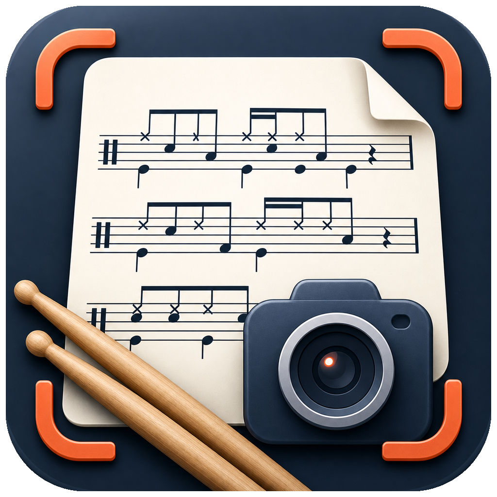

<p align="center">
  
</p>

<h1 align="center">Drum Sheet Capture</h1>

<p align="center">
  <strong>영상에 나오는 드럼 악보를, 연습할 때 펼쳐 볼 A4 PDF로.</strong><br>
  악보 영역을 한 번 정하면 줄을 모아 정리하고 마디 단위로 A4에 다시 배치합니다.
</p>

<p align="center">
  <a href="https://github.com/kr-ericshim/drum-score-capture-tool/releases/latest"><strong>설치 파일 다운로드</strong></a> ·
  <a href="#처음-사용하기">처음 사용하기</a> ·
  <a href="./README.ko.md">자세한 사용 가이드</a> ·
  <a href="./README.en.md">English</a>
</p>

<p align="center">
  <a href="https://github.com/kr-ericshim/drum-score-capture-tool/releases/latest"></a>
  <a href="./LICENSE"></a>
</p>

> **이 문서는 다음 공개 버전(현재 소스) 기준입니다.** v0.2.1 이하 설치 파일은 악보 화면을 페이지 이미지로 캡처하는 이전 방식이라 아래 설명과 다릅니다.

## 무엇을 하나요

- **영상 속 악보를 A4 PDF로** — 로컬 영상이나 공개 YouTube 영상에서 악보 줄을 읽어, 원본 악보 이미지를 깨끗하게 정리한 뒤 마디 단위로 A4에 다시 배치합니다(**clean reflow**). 제목은 영상 이름에서 자동으로 채워집니다.
- **검토하고 다시 만들기** — 줄마다 포함 여부와 순서를 고르고, 비슷해 보이는 줄을 나란히 비교하고, 제목을 고친 뒤 PDF를 다시 만듭니다.
- **원본 화면 대안** — 정리된 결과가 이상하면, 한 줄씩 나오는 영상에 한해 영상 화면을 그대로 담은 PDF(**원본 화면**)로 다시 만들 수 있습니다.

영상 처리는 내 컴퓨터에서 실행됩니다. **영상에 이미 보이는 악보를 옮기는 앱**이며, 소리를 듣고 악보를 만드는 채보나 음표 인식, MusicXML·MIDI 변환 기능은 없습니다.

## 어떤 영상에 맞나요

| 영상 | 상태 |
| --- | --- |
| 불투명한 판(밝거나 어두운 배경) 위에 **악보 한 줄**이 나오고, 그 줄이 통째로 다음 줄로 바뀌는 영상 | 지원 |
| 같은 줄 안에서 화면이 옆으로 넘어가는 영상(점프) | 실험 기능. 앱이 추정해 이은 곳은 검토 화면의 **이음새 확인**에서 영상과 비교합니다. |
| 반투명 판이나 움직이는 영상 위에 겹쳐 그린 악보 | 거부(지원하지 않는다고 알립니다) |
| 악보가 옆으로 흐르거나 여러 줄이 함께 위로 스크롤되는 영상 | 거부(지원하지 않는다고 알립니다) |
| 여러 줄이 한 페이지로 나오는 영상, 세로로 길게 내려가는 악보 | 범위 밖 |

## 다운로드와 설치

[최신 버전 다운로드 페이지](https://github.com/kr-ericshim/drum-score-capture-tool/releases/latest)의 **Assets**에서 컴퓨터에 맞는 파일을 받으세요.

| 사용하는 컴퓨터 | 받을 파일 | 설치 방법 |
| --- | --- | --- |
| Windows · Intel/AMD 64비트 | `.exe` | 설치 파일을 실행한 뒤 앱을 엽니다. |
| Mac · Apple Silicon(M 시리즈), macOS 13 이상 | `arm64.dmg` | DMG를 열고 앱을 **Applications(응용 프로그램)** 폴더로 옮깁니다. |

**Python, Node.js, FFmpeg를 따로 설치할 필요가 없습니다.** `Source code` ZIP은 설치 파일이 아닙니다. Intel Mac, Windows ARM64 전용, Linux 설치 파일은 제공하지 않습니다.

> **설치 중 보안 경고가 나오나요?** macOS 앱은 무료 ad-hoc 서명만 있고 Apple 공증은 없습니다. Windows 설치 파일은 서명되지 않습니다. 공식 저장소에서 받은 파일인지 확인한 뒤 [Windows 안내](./README.ko.md#windows) 또는 [macOS 안내](./README.ko.md#macos)를 따라 주세요.

## 처음 사용하기

**영상 선택 → 악보 영역 → 파일 만들기 → 검토 · 저장** 순서로 진행합니다.

1. **영상을 엽니다.** **파일 열기**로 고르거나 화면에 끌어 놓으세요. YouTube 영상은 주소를 붙여 넣고 Enter나 **유튜브 영상 준비**를 누릅니다.
2. **악보 영역을 정합니다.** 자동으로 추천된 영역은 고칠 수 있는 초안입니다. 음표·가사·반복 기호가 다 들어가는지 확인하고 **영역 적용**(또는 **적용하고 PDF 만들기**)을 누르세요.
3. **PDF를 만듭니다.** 필요하면 캡처 구간을 정하고 **PDF 만들기**를 누릅니다. 제목·연주자 등은 **PDF 정보 수정…**에서 넣을 수 있습니다.
4. **확인하고 저장합니다.** 줄 목록에서 포함 여부와 순서를 고르고, 바꿨다면 **PDF 다시 만들기**를 누르세요. **PDF 다른 이름으로 저장…**으로 원하는 폴더에 보관합니다.

[전체 사용 가이드](./README.ko.md#사용법) · [결과물](./README.ko.md#결과물) · [단축키](./README.ko.md#단축키) · [문제 해결](./README.ko.md#문제-해결)

## 자주 묻는 질문

<details>
<summary><strong>"지원하지 않는 영상"이라고 나와요.</strong></summary>

반투명 판이나 움직이는 영상 위에 겹쳐 그린 악보, 옆으로 흐르거나 여러 줄이 함께 스크롤되는 악보는 처리하지 않습니다. [어떤 영상에 맞나요](#어떤-영상에-맞나요)를 확인하세요.

</details>

<details>
<summary><strong>PDF에 빠지거나 두 번 나온 줄이 있어요.</strong></summary>

검토 화면의 **확인 필요**·**미완성** 안내와 **비슷해 보임** 표시를 먼저 보세요. 줄을 빼거나 다시 넣고 **PDF 다시 만들기**를 누르면 됩니다. 한 줄씩 나오는 영상이라면 **결과가 이상하면 원본 화면으로 다시 만들기**로 영상 화면을 그대로 담을 수도 있습니다.

</details>

<details>
<summary><strong>YouTube 영상을 가져오지 못해요.</strong></summary>

공개 영상인지 확인하고 **세부 진행**의 오류를 살펴보세요. 로그인·연령·지역 제한이나 YouTube의 동작 변경으로 실패할 수 있습니다. 같은 영상을 파일로 갖고 있다면 **파일 열기**로 진행하세요.

</details>

<details>
<summary><strong>파일은 어디에 저장되나요?</strong></summary>

앱이 관리하는 작업 폴더에 만들어집니다. 보관할 PDF는 **PDF 다른 이름으로 저장…**으로 따로 복사하세요. **보관함**은 영상별로 마지막에 만든 PDF를 찾는 기능이며 백업이 아닙니다.

</details>

<details>
<summary><strong>인터넷 없이 쓸 수 있나요?</strong></summary>

로컬 영상의 처리는 컴퓨터에서 합니다. YouTube 영상을 가져올 때와 업데이트를 확인할 때만 인터넷이 필요합니다.

</details>

다른 문제는 [문제 해결 가이드](./README.ko.md#문제-해결)를 보거나, 앱의 **문제 보고**나 [Issues](https://github.com/kr-ericshim/drum-score-capture-tool/issues)로 알려 주세요. **앱 버전, 운영체제, 영상 주소나 종류, 문제가 생긴 순서, 오류 메시지**가 있으면 원인을 찾는 데 도움이 됩니다.

## 개발 안내

설치 파일로 사용하는 분은 건너뛰어도 됩니다.

<a id="development"></a>
<details>
<summary><strong>소스로 실행하기 · 설치 파일 빌드하기</strong></summary>

개발 환경은 **Python 3.11**, **Node.js 22**를 사용합니다. 소스로 실행할 때는 `ffmpeg`와 `ffprobe`가 `PATH`에 있거나 `DRUMSHEET_FFMPEG_BIN` / `DRUMSHEET_FFPROBE_BIN`으로 지정되어 있어야 합니다.

저장소 루트에서 실행합니다. 기존 개발 환경이 있다면 먼저 확인하고 재사용하세요.

**macOS**

```bash
python3.11 -m venv backend/.venv
backend/.venv/bin/python -m pip install -r backend/requirements-build.lock
npm --prefix desktop ci
npm --prefix desktop start
```

**Windows PowerShell**

```powershell
py -3.11 -m venv backend/.venv
.\backend\.venv\Scripts\python.exe -m pip install -r backend/requirements-build.lock
npm --prefix desktop ci
npm --prefix desktop start
```

루트의 `easy_setup_mac.command` / `easy_setup_windows.bat`은 `backend/requirements.txt`와 `npm install`로 개발 환경을 만들고, `run_app_mac.command` / `run_app_windows.bat`은 `npm start`로 앱을 엽니다(더블클릭용). FFmpeg는 직접 준비해야 합니다.

테스트(저장소 루트):

```bash
PYTHONPATH=backend backend/.venv/bin/python -m unittest discover -s backend/tests -p 'test_*.py'
npm --prefix desktop run verify:renderer-v2
npm --prefix desktop run test:desktop-node
```

설치 파일은 대상 운영체제에서 빌드합니다. 먼저 `python3 scripts/media_bundle.py restore`(Windows는 `python`)로 검증된 FFmpeg·FFprobe 묶음을 준비하세요([미디어 도구 안내](./docs/release/media-toolchain.md)).

```bash
npm --prefix desktop run pack:release   # 설치 파일 없이 앱 패키지만 (로컬 확인용)
npm --prefix desktop run dist:release   # 설치 파일까지 (배포용)
npm --prefix desktop run smoke:packaged-electron
npm --prefix desktop run smoke:packaged-runtime
```

출력 위치는 `dist/`입니다. 배포 순서는 [릴리스 절차](./docs/release/github-release-runbook.md)와 [배포 점검표](./docs/release/final-production-checklist.md)를 따르세요.

| 경로 | 내용 |
| --- | --- |
| [`desktop/`](./desktop) | Electron 앱과 화면 |
| [`backend/`](./backend) | 로컬 영상 처리 엔진(clean reflow, 원본 화면) |
| [`docs/reflow/HANDOFF.md`](./docs/reflow/HANDOFF.md) | 현재 상태와 다음 할 일 |
| [`docs/reflow/DECISIONS.md`](./docs/reflow/DECISIONS.md) | 출력 규칙과 기본값 |
| [`docs/release/`](./docs/release) | 빌드·검증·배포 문서와 릴리스 노트 |

</details>

## 라이선스

프로젝트 소스는 [MIT 라이선스](./LICENSE)로 제공됩니다. 함께 배포되는 외부 구성 요소에는 각 구성 요소의 라이선스가 적용됩니다.
